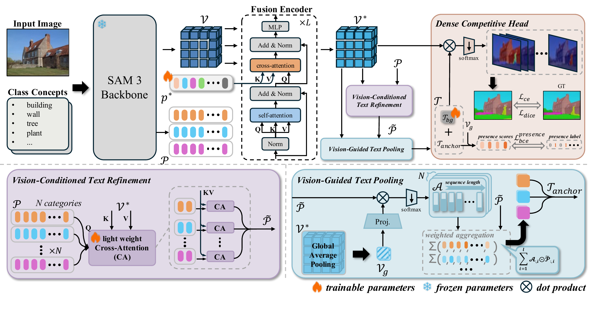

<div align="center">

## Efficient SAM3 Adaptation for Multi-Class Semantic Segmentation via Dense Competitive Representations

**Wenbin Liao<sup>1,2</sup> · Hao Zhu<sup>1,2</sup> · Yike Ma<sup>1</sup> · Hao Jiang<sup>1</sup> · Feng Dai<sup>1,*</sup>**

<sup>1</sup> Institute of Computing Technology, Chinese Academy of Sciences<br>
<sup>2</sup> School of Computer Science and Technology, University of Chinese Academy of Sciences

{liaowenbin23z, zhuhao22z, ykma, jianghao, fdai}@ict.ac.cn

<sup>*</sup> Corresponding author: [Feng Dai](mailto:fdai@ict.ac.cn)

[Overview](#overview) · [Get Started](#get-started) · [Usage](#usage) · [Citation](#citation)

</div>

Official PyTorch implementation of **DCR-SAM**, a framework for adapting SAM3 to multi-class semantic segmentation through dense competitive representations.

- **Efficient adaptation.** Share visual representations across class concepts while training lightweight adaptation components.
- **Visual guidance.** Refine and pool text features with image context through Vision-Conditioned Text Refinement (VCTR) and Vision-Guided Text Pooling (VGTP).
- **Joint class prediction.** Use a dense competitive head to resolve ambiguity between classes, with a learnable background token for datasets with a background category.

## Overview

<p align="center">
  
</p>

DCR-SAM combines shared visual features with image-conditioned class representations for dense semantic prediction. VCTR refines class text features using visual context, and VGTP aggregates the refined features into class anchors. The dense competitive head predicts classes jointly at each pixel. Training combines cross-entropy, Dice, and class-presence losses.

## Get Started

### Environment

The development environment uses:

| Component | Version |
| --- | --- |
| Python | 3.12 |
| PyTorch | 2.7.1 |
| torchvision | 0.22.1 |
| CUDA | 11.8 |

Install the SAM3 runtime dependencies in your PyTorch environment, along with the additional packages used by the training and evaluation scripts:

```bash
pip install pyyaml tensorboard tqdm pillow numpy matplotlib
```

Use the modified `sam3/` package included in this repository. Run all commands below from the repository root on a CUDA-enabled system.

### Pretrained Checkpoint

Download the SAM3 pretrained checkpoint and set its path in both configurations for your dataset:

| Configuration | Field |
| --- | --- |
| `configs/train_config/<dataset>.yaml` | `model.sam3_checkpoint` |
| `configs/eval_config/<dataset>.yaml` | `model.checkpoint_path` |

For example, if the checkpoint is stored at `pretrained_models/sam3/sam3.pt`, use that path for both fields. The tokenizer vocabulary is included at `assets/bpe_simple_vocab_16e6.txt.gz`; set `model.bpe_path` to this path.

### Data Preparation

The repository includes configurations and class prompts for the following datasets:

| Domain | Dataset | Configuration stem |
| --- | --- | --- |
| Natural images | ADE20K | `ade20k` |
| Natural images | Pascal Context-59 | `context59` |
| Natural images | COCO-Stuff | `coco_stuff` |
| Urban scenes | Cityscapes | `city_scapes` |
| Remote sensing | LoveDA | `loveda` |
| Remote sensing | iSAID | `isaid` |
| Remote sensing | Potsdam | `potsdam` |
| Remote sensing | Vaihingen | `vaihingen` |

1. Prepare the images and semantic annotations in the directory layout expected by the corresponding loader in `custom_datasets/`.
2. Set `data.root` in the training configuration and `dataset.root` in the evaluation configuration.
3. Use the matching class-name file in `text_prompt/` through `data.class_name_path` and `dataset.class_name_path`. Keep the class order consistent with the annotation labels.

## Usage

### Training

For example, train on ADE20K with four GPUs:

```bash
CUDA_VISIBLE_DEVICES=0,1,2,3 torchrun --standalone --nproc_per_node=4 \
  -m tools.train --config configs/train_config/ade20k.yaml
```

Adjust `CUDA_VISIBLE_DEVICES` and `--nproc_per_node` to match the available GPUs. For single-GPU training, use `CUDA_VISIBLE_DEVICES=0` and `--nproc_per_node=1`.

Adapter checkpoints, a copy of the configuration, and TensorBoard logs are saved in a timestamped run directory under `project.output_dir` (default: `checkpoints/`). The final adapter checkpoint is named `cdca_final.pth`.

To resume training, set `model.adapter_resume_path` to a saved adapter checkpoint in the training configuration, then rerun the command.

### Evaluation

Set `model.adapter_path` in the evaluation configuration to the trained adapter checkpoint, and keep `eval.batch_size: 1`.

```bash
CUDA_VISIBLE_DEVICES=0 torchrun --standalone --nproc_per_node=1 \
  -m tools.infer_ov_seg --config configs/eval_config/ade20k.yaml
```

Evaluation reports mIoU and per-class IoU, with summaries appended to `logs/eval_summary.txt`. To evaluate another dataset, use its corresponding configuration under `configs/eval_config/`.

The evaluation script imports `vis.visualizer.Visualizer`, which is not included in this repository snapshot. Provide this module before running evaluation, including when `eval.vis` is `false`. With the module available, set `eval.vis: true` to save segmentation visualizations under `vis_img/` beside the adapter checkpoint.

## Citation

If you find this work useful, please cite:

```bibtex
@misc{liao2026dcrsam,
  title  = {Efficient SAM3 Adaptation for Multi-Class Semantic Segmentation via Dense Competitive Representations},
  author = {Liao, Wenbin and Zhu, Hao and Ma, Yike and Jiang, Hao and Dai, Feng},
  year   = {2026}
}
```

## Acknowledgements

This project builds on [SAM3](https://github.com/facebookresearch/sam3). We thank the authors for making their code and pretrained models available.
